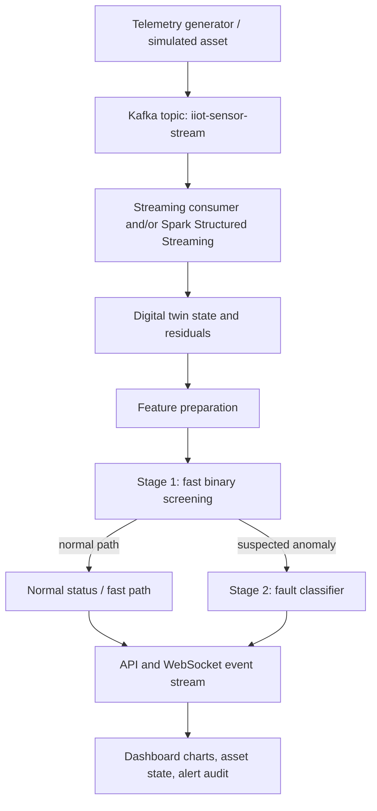

# Real-Time Digital Twin for Streaming-Based Anomaly Detection
## Project understanding, observed errors, and implementation guide

**Purpose of this document:** a source-grounded orientation based on the supplied project outline, dashboard screenshot, and runtime logs. The actual source repository was not included as a complete codebase in these materials, so file responsibilities below describe the *intended architecture in the supplied outline* and must be checked against implementation before being treated as verified source behaviour.

## 1. What the project is intended to do

The project simulates an Industrial Internet of Things (IIoT) asset—a motor and centrifugal pump—and attempts to detect abnormal operating conditions from sensor telemetry in a streaming pipeline. It combines three kinds of work:

1. **Telemetry generation and transport:** create sensor-like events and deliver them through Apache Kafka.
2. **Online analytics and diagnosis:** process incoming events, compare observed values with a mathematical digital twin, calculate residual-based features, and use machine-learning models to identify potential faults.
3. **Operational visibility and control:** serve a browser dashboard with live sensor charts, asset condition, fault injection, service status, and an anomaly/audit feed.

The supplied project brief describes a target ingestion rate of 10 Hz (roughly one event every 100 ms), a Spark Structured Streaming window of 5 seconds with a 1-second slide, and a two-stage inference design. These numbers describe the intended configuration in the brief; they are not established by the supplied error logs alone.

The dashboard screenshot shows a dark technical interface with sensor charts, a digital-twin illustration, a fault-injection panel, architecture blocks, and an audit feed. The main UI issues visible in the screenshot are compressed text, overly dense cards, weak hierarchy, and a large unused region on the left. A redesign should make the system easier to operate and read, not just add more effects.

## 2. Intended end-to-end flow

The project outline suggests this flow:

**Important architecture question:** the outline lists both `streaming/kafka_consumer.py` (a consumer feeding the digital-twin pipeline) and `streaming/spark_streaming_job.py` (a Spark job reading the same topic). The code needs to establish whether these are alternative modes, separate stages, or two independent consumers. They should not accidentally duplicate inference or alerts. A final architecture diagram must follow the actual implementation.

## 3. What each listed subsystem is supposed to do

The following file map comes from the supplied project outline, not an independent source-code inspection.

| Component | Intended responsibility | What to verify in code |
|---|---|---|
| `config/settings.py` | Shared rates, thresholds, topics, ports, and model settings | Whether every module reads common settings or hardcodes its own values |
| `data/generator.py` | Generate sensor telemetry with fault scenarios | Event schema, event timestamp, units, 10 Hz rate, and whether faults alter source telemetry |
| `data/dataset_benchmark.csv` | Offline benchmark dataset | Actual feature columns, label balance, split strategy, and provenance |
| `data/model_benchmark_results.json` | Stored benchmark results | Whether results are reproduced by the evaluation script or merely copied/stored |
| `models/digital_twin.py` | Virtual asset state, residuals, health index | Exact equations, units, feature order, bounds, and missing-value behaviour |
| `models/two_stage_ensemble.py` | Fast binary screening and fault classification | Actual model types, inference branching, class mapping, and prediction timing measurement |
| `models/train_models.py` | Train/save models and possibly compare baselines | The data split, leakage prevention, preprocessing fit, package versions, and reproducibility |
| `models/saved/` | Serialized model/scaler artifacts | Training version, expected feature count/order, artifact provenance, and compatibility |
| `streaming/kafka_producer.py` | Publish event stream to Kafka | Bootstrap server, topic creation/readiness, retry behaviour, delivery failures, and lifecycle |
| `streaming/kafka_consumer.py` | Consume messages and feed processing | Consumer group, deserialization, error handling, and overlap with Spark |
| `streaming/spark_streaming_job.py` | Windowed processing of Kafka events | PySpark version, Kafka connector/JAR, window/slide/watermark, checkpointing, and output sink |
| `streaming/stream_engine.py` | Possibly unify processing and WebSocket publication | Whether it is the source of dashboard data or duplicates the FastAPI responsibilities |
| `dashboard/templates/index.html` | Dashboard layout | Real controls, semantic markup, placeholders, and connection status behaviour |
| `dashboard/static/css/dashboard.css` | Styling and responsive layout | Contrast, font scale, grid behaviour, overflow, reusable variables |
| `dashboard/static/js/app.js` | WebSocket, controls, and UI behaviour | Reconnection logic, duplicate handlers, response/error rendering, and backend wiring |
| `dashboard/static/js/charts.js` | Streaming chart rendering | Source of every point, bounds, labels, memory limit, and stale-data indication |
| `dashboard/static/js/twin_visualizer.js` | Draw the motor/twin | Whether animation uses actual state rather than arbitrary animation |
| `server.py` | HTTP API, WebSocket, static dashboard and perhaps status controls | Lifespan/shutdown, endpoint schemas, background task ownership, and process safety |
| `run.py` | Local master runner | Process ownership, readiness, cleanup, environment assumptions, and whether it starts Kafka/Spark or only the web app |
| `evaluation/benchmark.py` | Evaluate metrics and latency | What “latency” measures, sample size, warm-up, reproducibility, and whether results support claims |

## 4. Digital-twin and model concepts

### 4.1 Residuals

The supplied brief defines a residual as the absolute difference between a measured/simulated sensor value and its virtual twin estimate:

\[
R_i(t) = |X_{sensor,i}(t) - \hat X_{twin,i}(t)|
\]

A residual becomes useful when compared against expected variation: large deviations may indicate a fault. The implementation must identify the signal's units and make sure the twin estimate is calculated from the correct state and time. If a sensor feature or twin value is missing, the system should not silently replace it with a misleading zero.

### 4.2 Normalized residual / z-score

The brief gives:

\[
z_i(t) = \frac{R_i(t)-\mu_i}{\sigma_i}
\]

Here, the reference mean \(\mu_i\) and standard deviation \(\sigma_i\) must come from a defined training/baseline period. A zero or near-zero \(\sigma_i\) needs a safe rule. At inference time, the scaler/statistics used must match training.

### 4.3 Composite Health Index (CHI)

The brief states:

\[
CHI(t) = 100 \times \exp\left(-\sum_i w_i z_i(t)\right)
\]

and also claims that CHI belongs to \([0,100]\). These two statements are not necessarily consistent: if the weighted sum is negative, the exponential exceeds 1, so the raw expression exceeds 100. The implementation should explicitly define and test how it maps results to a bounded health score (for example, a documented clamp/normalization), rather than relying on the claimed range without checking the math. Preserve the project's intended interpretation when making this correction and disclose it in the model documentation.

### 4.4 Two-stage inference

The project brief describes:

- **Stage 1:** a lightweight binary screen to classify a sample or feature vector as normal versus suspect.
- **Stage 2:** a more detailed classifier invoked when Stage 1 flags a potential anomaly.

The described diagnostic classes are normal operation, bearing defect, stator overheating, dynamic rotor imbalance, hydraulic cavitation/pressure loss, and sensor drift/calibration degradation. Confirm the actual class indices and names against the trained model and training label map; do not trust a class-name table copied from a report if its numeric mapping differs from code.

### 4.5 Reported metrics are not automatically verified metrics

The supplied brief lists 99.71% accuracy and 4.78 ms average latency for the proposed ensemble, alongside baseline models. Treat those as reported values until `evaluation/benchmark.py` can reproduce them from the supplied dataset and model with a documented split and timing method. The dashboard should distinguish:

- values arriving from current live stream;
- metrics from a local benchmark run;
- metrics reported by the cited paper.

These should never be presented interchangeably.

## 5. Current logged errors: diagnosis and next action

### Error A — Kafka: `NoBrokersAvailable`

**Observed:** `kafka_consumer.py` tries to connect to `localhost:9092`, resolves IPv6 loopback `::1`, and reports `NoBrokersAvailable`.

**Likely cause:** no Kafka broker is running at that address/port, the listener is configured differently, or the process is running in a container where `localhost` points to itself instead of the Kafka service.

**Fix and verify:**

1. Make the broker a Compose service and give it a health check.
2. Use a configuration value such as `KAFKA_BOOTSTRAP_SERVERS` rather than hardcoding the address in multiple modules.
3. From another container, use the Compose DNS hostname and internal listener port (for example, `kafka:9092` if the Compose service is named `kafka`). From host tools, use the published host listener only if configured.
4. Ensure the expected topic `iiot-sensor-stream` exists or is created automatically.
5. Add bounded retry/backoff; show `starting`, `disconnected`, and `failed` states separately.
6. Verify by publishing a test event and observing the consumer receive it; a successful TCP connection alone does not prove end-to-end processing.

### Error B — Spark: `Failed to find data source: kafka`

**Observed:** Spark Structured Streaming fails when it attempts to read the Kafka stream, saying the data source `kafka` could not be found.

**Likely cause:** the JVM-side Spark Kafka connector was not included. Installing a Python Kafka package does not provide Spark's Kafka source plugin.

**Fix and verify:**

1. Read the exact PySpark/Spark version from the environment.
2. Resolve its Scala binary version.
3. Include the matching `org.apache.spark:spark-sql-kafka-0-10_<scala-binary-version>:<same-spark-version>` package/JAR in the Spark runtime.
4. Prefer pinning this dependency in the Docker image or Spark submit configuration.
5. Launch a small integration test that starts the query against the broker and observes at least one input event.

Do not pick a connector version independently of Spark. A version mismatch can create a different failure rather than fixing the current one.

### Error C — scikit-learn artifact version mismatch

**Observed:** saved estimators `StandardScaler`, `SGDClassifier`, `ExtraTreeClassifier`, and `ExtraTreesClassifier` report that they were serialized with scikit-learn 1.5.1 and are being loaded by version 1.9.1.

**Cause:** the training/artifact environment differs from the inference environment. Pickle/joblib model persistence is not guaranteed to be backward/forward compatible across scikit-learn versions.

**Fix and verify:**

- Best minimal fix: run inference with the artifact-compatible version if it is compatible with the selected Python/dependency stack.
- Alternative: retrain and re-export all related estimators and scalers using the selected pinned inference version.
- Store the scikit-learn version, feature names/order, training date, dataset identifier, and model identifier with each artifact.
- Load each artifact in the final container and run a deterministic test input through the full inference pipeline.
- Do not simply suppress `InconsistentVersionWarning`.

### Error D — Spark on Windows: `winutils.exe` / Hadoop warnings

**Observed:** Spark warns that `HADOOP_HOME` and `hadoop.home.dir` are unset and that the native Hadoop library could not be loaded.

**Interpretation:** these warnings commonly arise from running Spark directly on Windows. They may not be the cause of the Kafka data-source failure; the log explicitly reports a missing Kafka data source separately.

**Preferred solution:** run the Spark job in a Linux container with a supported Java/PySpark configuration. This avoids relying on ad-hoc Windows Hadoop binaries. If native Windows use remains a supported target, document and test its additional setup independently.

### Error E — PySpark warns about pandas 3.x

**Observed:** the current PySpark installation warns that pandas >= 3.0 is not fully supported.

**Fix:** pin a pandas version supported by the selected PySpark release (the prompt requires checking compatibility; do not guess blindly), or deliberately upgrade and test the Spark version. Record the resolved version set in the lock file and Docker build.

### Error F — Uvicorn shutdown traceback with `KeyboardInterrupt` and `CancelledError`

**Observed:** the log shows a `KeyboardInterrupt`, followed by an `asyncio.CancelledError` inside a WebSocket endpoint sleeping while the server is shutting down.

**Interpretation:** this log appears to occur during manual Ctrl+C shutdown. It may be an expected cancellation path rather than an independent startup failure. It does not explain the Kafka broker error or missing Spark Kafka connector.

**Fix:** handle WebSocket disconnect and task cancellation at the relevant task boundary; cancel and await background tasks during application shutdown; stop subprocesses gracefully; and keep real exceptions visible. Test normal manual shutdown separately from an unexpected worker crash. Do not catch every exception and discard it.

### Error G — potential Python environment mismatch

**Observed:** logs contain project files under a PyCharm project path but show Python packages inside a virtual environment located beneath a separate Downloads folder.

**Possible cause:** the IDE interpreter points at a different project's virtual environment or environment setup is inherited accidentally.

**Fix:** verify the PyCharm interpreter, launch configuration, `sys.executable`, working directory, package lock, and model versions. The Docker build must install all dependencies from project-owned dependency files and must not refer to a host user's directory.

## 6. Target operating model: no separate terminals for routine use

Use Docker Compose to provide predictable service discovery and dependencies. Provide a Windows `start.bat` launcher that checks whether Docker Desktop/Engine is reachable, builds and starts the stack, waits for the app's health endpoint, and opens the dashboard. A corresponding `stop.bat` may stop the stack without deleting persistent volumes.

The dashboard should offer service-level controls for the producer, consumer/twin worker, and Spark job, plus fault activation/reset and bounded log viewing. The broker can also be controllable if a safe allowlisted lifecycle controller is provided. Keep the dashboard/API control plane alive while operators use these controls.

There is a real limitation here: if the browser is served by the only API process and that process is stopped, the UI cannot call the API to restart itself. Therefore, “Stop All Processing” should stop workers while leaving the API/dashboard/control-plane alive. The complete stack can be stopped from the launcher; restarting it should be possible by double-clicking the launcher, not by opening a terminal.

Never mount the Docker socket inside a publicly reachable web/API container just to make buttons work. If container-level lifecycle operations are required, use a separate internal controller with a small fixed allowlist of actions/services and no arbitrary command execution. Keep it on a private Compose network and document that this is a local development control plane.

## 7. Proposed implementation order

1. **Inventory and baseline:** verify actual files, Git state, Python/Spark/Java versions, model artifact versions, broker config, event schema, WebSocket payloads, and available tests.
2. **Stabilize dependencies:** pin Python libraries, match model artifacts, align Spark with the Kafka connector, and externalize host-specific settings.
3. **Make one authoritative event flow:** specify schema, topic, consumer groups, processing responsibility, alerts, and UI event shape; remove accidental duplicate pipelines.
4. **Dockerize and prove connectivity:** Compose health checks, Kafka DNS/listener setup, topic readiness, app health, Spark connector, and integration event.
5. **Create lifecycle control API:** service registry/state reconciliation, start/stop/restart, sanitized bounded logs, timeouts, idempotency, and fault controls.
6. **Redesign dashboard:** improve visual hierarchy, typography, spacing, responsiveness, readable charts, operational states, truthful metrics, fault controls, and audit logs.
7. **Add launchers:** double-click start/stop for Windows; verify that the launcher opens the dashboard only after readiness.
8. **Tests:** unit + API + broker integration + Spark source availability + UI smoke checks + graceful shutdown.
9. **Documentation:** update README and generate architecture, component, model/metrics, operations, troubleshooting, validation, roadmap, and one comprehensive master guide.
10. **Final verification:** start from a fresh build, test a fault, reset, stop/restart workers through the UI, review logs, and record exactly what passed.

## 8. Completion checklist

- [ ] Dashboard uses the screen efficiently and is readable at laptop size.
- [ ] Every displayed metric has a real source and unit or is marked not available.
- [ ] WebSocket and HTTP states recover after transient disconnects.
- [ ] Fault-injection buttons change the telemetry consumed by the actual pipeline.
- [ ] Reset returns the source to normal and this becomes visible in readings and audit state.
- [ ] Kafka DNS/listener settings work for host and container contexts.
- [ ] Spark has the exact matching Kafka connector and can consume a real test event.
- [ ] Model artefacts load under a compatible pinned runtime; no unresolved version mismatch.
- [ ] Compose starts the required project with a reproducible build and health checks.
- [ ] Windows double-click startup works without manually opening multiple terminals.
- [ ] Per-service lifecycle actions perform real backend operations and report success/failure based on observed state.
- [ ] Stop operations do not leave orphan workers and expected cancellation is quiet.
- [ ] Benchmark values are labelled accurately as reported, reproduced, or live measured.
- [ ] Deep documentation explains the architecture, each component, operational steps, error fixes, metrics and development path.
- [ ] Final validation report says what was and was not tested.

## 9. Further reading already identified in the supplied brief

The project notes cite: A. Ranpariya and S. Sharma, “A digital twin solution for fault detection in time-critical IIoT applications,” *Journal of Simulation*, vol. 19, no. 4, pp. 441–454, 2025, DOI: [10.1080/17477778.2025.2453725](https://doi.org/10.1080/17477778.2025.2453725).

Treat this as the reported baseline reference. Any statement that this implementation reproduces the paper's reported accuracy, latency, or architecture needs evidence from the actual code and evaluation process.
